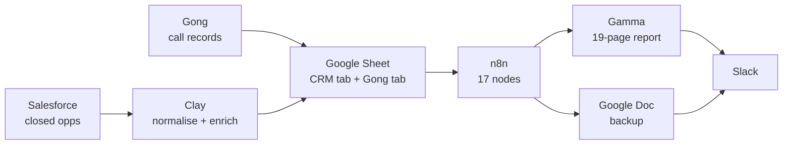
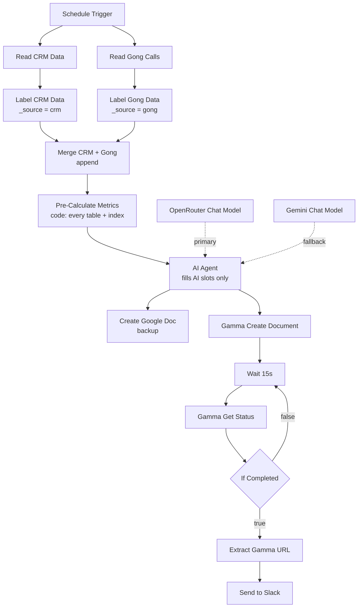

# Deal Agent

Closed-deal intelligence for B2B sales teams. Closed-won and closed-lost opportunities come out of the CRM through Clay, and recorded sales calls come out of Gong. A 17-node n8n workflow scores every segment, writes a 19-page ICP intelligence report in Gamma, keeps a Google Doc backup, and posts both links to Slack.

**Stack:** Salesforce · Gong · Clay · Google Sheets · n8n · OpenRouter (Claude) · Gemini · Gamma API · Google Drive · Slack

---

## The problem

Sales leaders want to know who they win with, who they lose to, and why. The CRM can answer the first two. It can't answer the third: the Win/Loss Reason field was never filled in, so any loss reason built on CRM data alone would be made up.

So the Deal Agent reads a second source. Gong call records hold the pain points buyers raised, the objections, the competitors mentioned, whether budget came up, and whether each call moved the deal forward or stalled it. The CRM half says **where** the wins are. The Gong half says **why**. Neither one is a report on its own.

## Scope

**In scope**
- Closed-won and closed-lost new-business opportunities for one product line
- Gong calls on those accounts, filtered to the same product line
- Segment scoring across headcount, US state, country, industry, company type, customer type and revenue band
- Rep patterns, call outcomes, deal risk, budget signals, competitor mentions, pain points and objections
- A fixed 19-page report: ICP clusters, segment analysis, voice of customer, anti-ICP hard stops, buyer persona, SDR targeting brief, ICP tiers, methodology

**Out of scope**
- Open pipeline forecasting (closed deals only)
- Amendments and contract changes (excluded so they don't inflate new business)
- Retention, churn and margin (the CRM has no fields for them, and the report says so)
- Writing anything back to the CRM

## Architecture



Clay owns data preparation. n8n owns scoring, writing and delivery. A plain Google Sheet sits between them on purpose: the client can read it without access to either platform, and either side can be swapped without touching the other.

### Inside n8n



## The build, stage by stage

| # | Stage | Where | What happens |
|---|---|---|---|
| 1 | Pull closed opportunities | Clay ← Salesforce | Closed-won and closed-lost accounts for the chosen window (usually the quarter just finished). |
| 2 | Normalise and hold the floor | Clay | Stage values, dates, currency and account names are cleaned up. If the normalised data is under 80% accurate, the run stops here, because everything downstream inherits the error. |
| 3 | Enrich | Clay | Size band, industry, standardised geography, company type. These are the exact dimensions the report scores by, and the CRM rarely holds them cleanly. |
| 4 | Label and merge | n8n: Set + Merge | Both tabs are read in parallel and stamped with `_source`, then **appended**, not joined. The two sources share no key, and a join would drop every row that doesn't match. |
| 5 | Score everything | n8n: Code | Amendments excluded, ARR strings parsed to numbers, blanks left out of averages instead of counted as zero, Gong filtered to the product line. Then every segment is scored and indexed. The output is the finished report as markdown, with marked gaps where judgment is needed. |
| 6 | Fill the gaps | n8n: AI Agent | Replaces each `[AI: ...]` slot and leaves everything else untouched. OpenRouter is primary, with Gemini as fallback. |
| 7 | Back up and render | n8n: Drive + Gamma | The output goes to a Google Doc and to Gamma. Page markers become card breaks, and `###` subsections become coloured callout cards. |
| 8 | Deliver | n8n: Slack | The Gamma link and the backup doc link are posted together with headline numbers. Nobody has to open n8n to get their report. |

### Why the merge works this way

```
Read CRM sheet  → Set _source = crm  ┐
                                      ├→ Merge (append) → Code splits on _source
Read Gong sheet → Set _source = gong ┘
```

Both datasets arrive whole and every row knows where it came from.

## ICP scoring

Conversion rate alone rewards cheap, easy wins. Revenue alone rewards deals you rarely close. The score weights both and measures each segment against the overall average, not against zero.

```
ICP Score = (0.6 × CvR_norm) + (0.4 × AvgARR_norm)
Index     = ICP Score × 100

CvR_norm    = segment CvR ÷ overall CvR
AvgARR_norm = segment avg ARR ÷ overall avg ARR
```

| Index | Label | Meaning |
|---|---|---|
| > 110 | PRIORITISE `^` | More than 10% above average, earns budget |
| 90–110 | NEUTRAL `--` | Within 10% of average, called neutral, not spun either way |
| < 90 | DEPRIORITISE `v` | More than 10% below average |

**Minimum sample sizes.** A segment is only scored once it clears a floor, so a 100% win rate on two deals never shows up as the best segment in the business.

| Dimension | Minimum opps |
|---|---|
| FTE band | 5 |
| US state | 3 |
| Industry | 5 |
| Company type | 5 |
| Revenue band | 3 |

## The prompt contract

The model never does arithmetic. The code node builds the whole report first: every table, total, index and page break. Wherever judgment is needed, it leaves a slot like `[AI: Write 3-4 insights about FTE patterns... Compare each band to TOTAL... Cite the Index numbers.]` with instructions for that slot alone.

The agent's rules:
- Replace every `[AI: ...]` slot and change nothing else
- Keep every table and every column, including Index
- Keep every `===PAGE_BREAK===` marker
- Compare every insight to the TOTAL row and cite the index it's arguing from

There's no step where the model gets raw rows and is asked for a total, so the numbers can't drift. See [`docs/sample-report-skeleton.md`](docs/sample-report-skeleton.md) for exactly what the agent receives (synthetic data).

## Failure handling

| Risk | How it's handled |
|---|---|
| LLM provider outage | Gemini is set as a fallback model on the agent, so an outage delays the report instead of killing the run |
| Gamma render fails | The Google Doc backup runs in parallel, so the full analysis survives a failed render |
| Gamma still generating | Wait 15s → check status → loop until `completed` |
| Two tiny deals look like the best segment | Minimum sample sizes per dimension |
| Contract changes inflate new business | Amendment record types excluded |
| Blank ARR drags averages down | Blanks excluded from averages, not counted as zero |
| Calls about other products pollute the analysis | Gong rows filtered to the configured product line |
| Bad upstream data | 80% accuracy floor enforced in Clay before the sheet is written |

## Known limitations

These are stated honestly, and the report's last page lists the data limits on every run.

- **The Gamma retry loop has no cap.** If Gamma never returns `completed`, the workflow keeps polling until n8n's execution timeout. The fix is a counter and an alert branch after N attempts.
- No Win/Loss Reason in the CRM, which is the whole reason Gong is read.
- No retention or margin fields, so the report says nothing about either.
- Pain points and objections are free text, so they're summarised, not counted precisely.
- Competitor mentions only reflect what reps logged, so they may be undercounted.
- New business only (amendments excluded).

## How to import

1. In n8n: **Workflows → Import from File →** `workflow/deal-agent.json`
2. Open **Pre-Calculate Metrics** and edit the `CONFIG` block at the top: company name, product name, the Gong product-line match, a one-line product context, and known competitors. That's the only code you need to touch.
3. Create a Google Sheet with two tabs, `CRM Closed Opps` and `Gong Calls` (columns below), and paste its URL into both **Read** nodes.
4. Add credentials:
   - Google Sheets + Google Drive (OAuth2)
   - OpenRouter and Google Gemini (PaLM) API
   - Gamma: **Header Auth** credential, name `X-API-KEY`, value = your Gamma key, attached to both Gamma nodes. Never paste the key into the node itself.
   - Slack (OAuth2), then set the channel
5. Set the **Schedule Trigger** to your cadence (quarterly recommended), or run it manually.

### Expected columns

**CRM Closed Opps** (Clay export)

| Column | Used for |
|---|---|
| `Opportunity.Stage Name` | `Closed Won` / `Closed Lost` |
| `Opportunity.Record_Type_Name_C` | `Amendment` rows are excluded |
| `Opportunity.Annualized_Bookings_Conversion_C.CONVERT` | ARR, e.g. `USD 24,203.64` |
| `Opportunity.Owner_Name_C` | Rep performance |
| `Size`, `Number Of Employees` | FTE band |
| `State`, `Country` | Geography |
| `Industry (2)`, `Industry` | Industry (enriched value preferred) |
| `Company Type` | Public / private / partnership… |
| `Type` | `New Customer` / `Existing Customer` |
| `Annual Revenue` | Revenue band |

**Gong Calls**

| Column | Used for |
|---|---|
| `Product Line` | Filtered against `CONFIG.productLineMatch` |
| `Deal Status`, `Has Closed Won` | Won / lost / pipeline account split |
| `Call Type`, `Call Outcome` | Discovery vs demo, advancing vs stalled |
| `Deal Risk`, `Budget Signal` | Risk distribution, budget timing |
| `pain_points`, `objections` | Voice of customer |
| `Competitors` | Comma-separated mentions |
| `Rep Name`, `ICP` | Rep patterns, ICP classification |

## The report: 19 pages, fixed order

The order is set in code, so every run can be compared with the last one.

1. Key Metrics
2. ICP Cluster Definitions
3. Executive Summary
4. FTE Band Analysis
5. Geography Analysis
6. Industry Analysis
7. Company Type Analysis
8. Customer Type Analysis
9. Annual Revenue Band
10. Sales Rep Performance
11. Conversation Intelligence
12. Voice of Customer
13. Competitive Intelligence
14. Deal Signal Analysis
15. Anti-ICP Hard Stops
16. Buyer Persona
17. SDR Targeting Brief
18. ICP Definition (Tier 1 / 2 / 3)
19. Appendix: Methodology

## Cadence

Run it quarterly. One report shows where you won and lost last quarter. Four of them, built the same way with the same page order, show what's moving. By annual planning the analysis already exists, so the plan is built on what happened, not on what the room remembers. The window is a parameter, not a rebuild.

---

Built by Chris Mbanta · GTM Engineer
